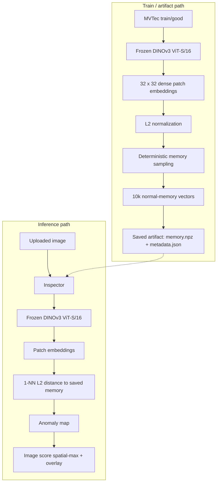

# InspectAI

Industrial Visual Anomaly Detection with DINOv3, Patch Memory,
and Explainable Defect Localization

InspectAI is a **portfolio / research prototype** for industrial visual
anomaly detection. It is evaluated on the MVTec AD **transistor** category.
It is not a production-deployed factory system.

## Overview

Manufacturing typically yields many defect-free parts and relatively few
examples of every possible defect. New failure modes also appear over time.

InspectAI therefore does **not** train a closed supervised classifier for
known defect names. It models **normal** visual structure from good training
images, then flags and localizes deviations at test time.

The v1.0 stack covers dataset analysis, reusable MVTec loading, four locked
one-class experiments, a saved DINOv3 memory artifact, a reusable
`Inspector` API, and a Streamlit demo.

## Key Results

Locked evaluation on the official MVTec transistor test split
(100 images; 60 good, 40 defective). Fitting used **train/good only**.
Test labels were not used for model selection or hyperparameter tuning.

| Method | Image AUROC | Pixel AUROC |
| --- | ---: | ---: |
| Convolutional Autoencoder | 0.6158 | 0.5898 |
| Frozen ResNet18 patch-kNN | **0.9800** | 0.7866 |
| PatchCore-style ResNet18 | 0.9479 | 0.7689 |
| Frozen DINOv3 ViT-S/16 | 0.9646 | **0.9663** |

- **ResNet18 patch-kNN** had the highest image-level AUROC (0.9800).
- **DINOv3** dramatically improved localization: pixel AUROC **0.7866 → 0.9663**
  versus the simple ResNet patch-kNN baseline.
- DINOv3 was selected for the interactive Inspector because it provided the
  strongest **detection/localization balance**, not because it won every metric.
- PatchCore-style extra complexity did **not** improve the simpler ResNet
  baseline on this category.
- Autoencoder reconstruction was substantially weaker.

Do not over-interpret tiny per-defect gaps: each defect type has only
**10** official test images.

DINOv3 per-defect image AUROC (locked): bent_lead 0.975, cut_lead 0.8967,
damaged_case 1.000, misplaced 0.9867.

## Problem Formulation

**One-class / normality modeling**

- Train / fit: normal (`train/good`) samples only.
- Inference: extract representations from a test image and compare them
  with the learned notion of normality (reconstruction error or nearest
  neighbor in a normal memory bank).

**Image-level detection** scores whether the whole image is anomalous
(spatial maximum of the map in all locked experiments).

**Pixel-level localization** scores how well the anomaly map matches the
ground-truth defect mask (pixel AUROC).

## Dataset

[MVTec AD](https://www.mvtec.com/company/research/datasets/mvtec-ad)
**transistor** category (not redistributed in this repository).

| Split | Contents |
| --- | --- |
| Train | 213 good images |
| Official test | 100 images: 60 good + 40 defective |
| Defect types | `bent_lead`, `cut_lead`, `damaged_case`, `misplaced` (10 each) |
| Native size | ~1024×1024 RGB |

EDA (see `notebooks/01_mvtec_eda.ipynb`) showed that some defects occupy
very small image regions. That motivated patch-based scoring at relatively
high resolution rather than relying only on a global embedding.

## Architecture

Final Inspector path (locked M7 representation + saved memory):



## Methods

All four methods were registered before official test evaluation and then
locked. See `docs/` for experiment contracts.

### Autoencoder

A convolutional autoencoder trained only on normal images. Anomaly score is
reconstruction error. Weaker on this category: low validation MSE did not
imply useful defect discrimination.

### Frozen ResNet18 patch-kNN

ImageNet-pretrained ResNet18, frozen. `layer3` patch features, k=1 nearest
normal patch, spatial-max image score. Strongest image AUROC.

### PatchCore-style

Frozen ResNet18 `layer2`+`layer3` concatenated at aligned resolution, then a
deterministic 50k candidate pool and greedy coreset to 10k memory vectors.
On transistor, this did **not** beat the simpler M4 baseline.

### DINOv3

Official frozen DINOv3 ViT-S/16 dense patch tokens (not the CLS token),
L2-normalized, 10k deterministically sampled normal memory, k=1 L2, spatial
max. Best pixel AUROC and the selected demo backbone.

## Experimental Protocol

- Fitting used `transistor/train/good` only.
- Each locked experiment used the official test split only for its final
  evaluation.
- Test labels were not used for model selection, hyperparameter tuning,
  architecture search, or threshold fitting.
- Experiment YAML contracts were locked before evaluation.
- Shared metrics: overall image AUROC, per-defect image AUROC, pixel AUROC,
  qualitative panels (highest-scoring goods, lowest-scoring defects).

## Main Findings

1. Low reconstruction loss did not imply good anomaly discrimination.
2. Frozen pretrained patch representations dramatically outperformed the
   Autoencoder.
3. The M6 PatchCore-style multi-scale coreset did not automatically improve
   the simpler ResNet patch-kNN baseline.
4. DINOv3 representations produced much sharper localization.
5. Representation quality mattered more for localization here than adding a
   more complicated memory-selection mechanism.
6. Spatial-max image scoring can still let isolated unusual background
   patches outrank subtle defects such as `cut_lead`. **Point 6 is post-hoc
   qualitative analysis** and was not used to retune scoring.

## Qualitative Results

Representative overlay panels are generated locally under
`outputs/experiments/` (gitignored). They are **not** committed: MVTec AD
images are licensed for research use and must not be redistributed, including
as overlay screenshots that still contain the original photographs.

After you run the locked experiments (or inspect locally), useful DINOv3
panels include bent-lead, damaged-case, and misplaced overlays, plus
high-scoring normal examples. See [docs/m7_transistor_dinov3.md](docs/m7_transistor_dinov3.md)
and [docs/assets/README.md](docs/assets/README.md).

## Inference System

The normal memory bank is built **once** from train/good and saved. The
Inspector loads that artifact; it does not rebuild memory at startup.

```python
from inspectai.inference import Inspector

inspector = Inspector.load("outputs/artifacts/dinov3_transistor")
result = inspector.inspect(image)

print(result.anomaly_score)
print(result.latency_ms)
```

`InspectionResult` also includes `anomaly_map`, `overlay`, `model_name`,
`input_hw`, and `patch_grid`. No NORMAL/DEFECTIVE label is assigned unless
the caller supplies an explicit threshold. No such threshold was fit on
official test labels.

## Installation

Python **3.11+**. Windows (PowerShell):

```powershell
python -m venv .venv
.\.venv\Scripts\Activate.ps1
python -m pip install -e ".[dev,dinov3,demo]"
```

DINOv3 weights (`facebook/dinov3-vits16-pretrain-lvd1689m`) are gated on
Hugging Face under the DINOv3 License. Accept the license on the model card
and run `hf auth login` with a token that can download that repo.
Do not commit tokens.

CPU is supported. CUDA is used when requested and available.

## Dataset Setup

Download MVTec AD yourself and place the transistor category here (not
committed):

```text
data/raw/transistor/
    train/
    test/
    ground_truth/
```

## Build DINOv3 Memory

Uses **train/good only**. Not a new experiment; locked M7 configuration.

```text
python scripts/build_dinov3_memory.py --root data/raw --category transistor --output outputs/artifacts/dinov3_transistor
```

PowerShell:

```powershell
python scripts/build_dinov3_memory.py `
  --root data/raw `
  --category transistor `
  --output outputs/artifacts/dinov3_transistor
```

## CLI Inference

```powershell
python scripts/inspect_image.py `
  --image path\to\image.png `
  --artifact outputs\artifacts\dinov3_transistor `
  --output outputs\demo\example
```

Writes `result.json`, `anomaly_map.png`, and `overlay.png`.

## Streamlit Demo

```text
streamlit run app/streamlit_app.py
```

Upload a PNG/JPEG, click **Inspect Image**, and view the original, heatmap,
and overlay plus score and latency. The demo does **not** show
NORMAL/DEFECTIVE by default: no independent production threshold has been
established.

## Project Structure

```text
app/streamlit_app.py     Interactive demo
configs/experiment/      Locked experiment contracts
docs/                    Experiment write-ups and v1.0 results
notebooks/               Transistor EDA only
scripts/                 Thin CLIs
src/inspectai/           Package: data, models, evaluation, inference
tests/                   pytest (no full MVTec evaluation)
data/raw/                Local MVTec (gitignored)
outputs/                 Local runs, artifacts, demo (gitignored)
```

## Testing

```text
python -m pytest
python -m ruff check .
```

See the latest counts in [docs/release_checklist.md](docs/release_checklist.md)
after a clean local run.

## Limitations

- Evaluated primarily on **one** MVTec category (transistor).
- Official test set is small (100 images; 10 defectives per type).
- No independently validated deployment decision threshold.
- CPU inference was about **1–2 seconds/image** on the development laptop.
- Exact nearest-neighbor memory has compute and RAM cost.
- Image score is spatial max (sensitive to isolated high-response patches).
- No factory-line or domain-shift evaluation.

## Future Work

Not implemented in v1.0:

- Independent validation/calibration of a decision threshold
- Top-k / percentile image aggregation on a **separate** validation protocol
- Additional MVTec categories / MVTec AD 2
- Domain-shift study
- Approximate nearest-neighbor indexing
- Optional video / product tracking
- Few-shot adaptation

## Documentation

Start at [docs/README.md](docs/README.md).

## License

InspectAI source code is MIT (see `LICENSE`). MVTec AD and DINOv3 weights
remain under their own licenses and are not included in this repository.
